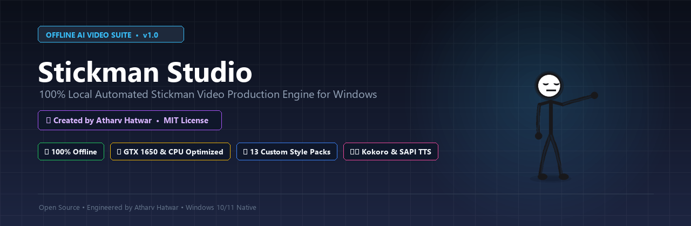
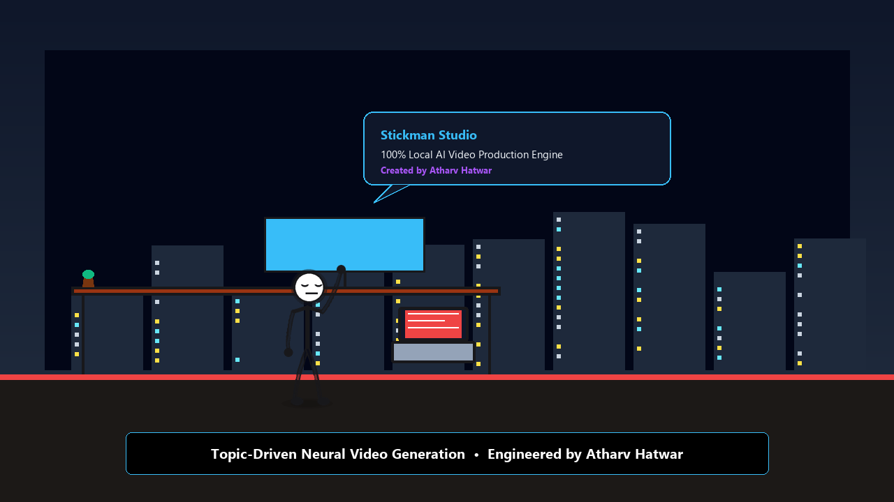
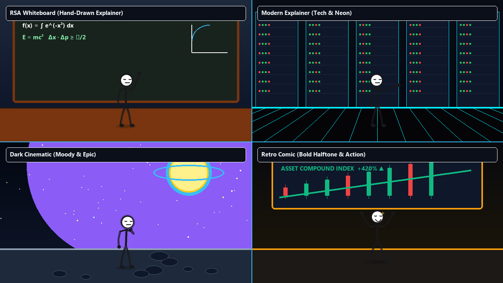

<p align="center">
  
</p>

<p align="center">
  <a href="https://github.com/atharv01h"></a>
  <a href="https://github.com/atharv01h/Stickman-Studio"></a>
  
  
  
  
  
</p>

---

# 🎬 Stickman Studio

> **Designed and Engineered by [Atharv Hatwar](https://github.com/atharv01h)**  
> An autonomous, 100% local, offline AI video production suite for Windows. Turn any topic or script into a fully animated, professionally narrated, kinetic stickman video in minutes — with zero external AI daemons, zero subscriptions, zero cloud APIs, and zero internet connectivity.

---

## 🌟 Overview

**Stickman Studio** brings studio-grade animated video production straight to consumer hardware. Built specifically to run seamlessly on standard laptops and desktops (such as an AMD Ryzen 5 with an NVIDIA GTX 1650 and 8 GB RAM), it orchestrates an embedded in-process AI Director, procedural vector kinematics, procedural sound synthesis, neural text-to-speech, and hardware-accelerated video rendering into a polished, one-click experience.

<p align="center">
  
</p>

---

## ✨ Key Highlights

- 🔒 **100% Local & Air-Gapped**: Zero cloud reliance. No OpenAI, no ElevenLabs, no subscriptions, no telemetry. Once initialized, disconnect your Wi-Fi and create unlimited videos.
- 🎯 **One-Click Topic-to-Video Workflow**: Simply type a topic or paste a script, pick an artistic style, and click **Generate Video**. The engine handles scripting, scene decomposition, procedural animation, voice acting, audio synthesis, and final MP4 encoding.
- 🎨 **14 Distinct Visual Style Packs**: From classic RSA Whiteboard to Modern Explainer, Dark Cinematic, Retro Comic, 2.5D Cinematic Storyteller, and the new **S14 Chameleon Dynamic Adaptive** mix.
- 🧠 **Context-Aware Semantic Backgrounds**: Dual background generation pipeline featuring **Procedural Vector Architecture** (clean geometric offices, gymnasiums, trading floors, abstract thinking planes) and **LCM DreamShaper AI** (4-step ultra-fast diffusion backgrounds).
- 🏃 **Lifelike Character Kinematics**: Natural 3-phase acting model (anticipation $\to$ expressive hold $\to$ settling cadence) with authentic physical lean, procedural blinking, breathing cycles, and expressive hand gestures.
- 🎥 **Smart Director Choreography**: Dynamic camera framing, establishing wide shots, cinematic zoom cuts, camera pans, kinetic word-highlight subtitles, and speech bubbles.
- 🔊 **Built-In Sound Design**: Programmatic DSP synthesis generates ambient background music stems and sound effects (pop, whoosh, impact, success) on the fly with sidechain ducking.
- ⚡ **Optimized for Consumer Hardware**: Specially tuned to run smoothly within 4 GB VRAM (GTX 1650) and 8 GB system RAM.

---

## 🎨 Visual Style Showcase

Stickman Studio includes **13 handcrafted visual styles**, each featuring tailored palettes, lighting models, typography, stroke weights, and ambient rendering:

<p align="center">
  
</p>

### The 13 Visual Styles:

| ID | Style Name | Description | Color Palette & Aesthetics |
|---|---|---|---|
| `s1` | **RSA Whiteboard** | Classic educational hand-drawn explainer | Crisp white canvas, blueprint ink, dry-erase marker textures |
| `s2` | **Modern Explainer** | Tech/SaaS startup presentation style | Deep navy/slate backdrop, neon cyan & purple glowing accents |
| `s3` | **Dark Cinematic** | Moody, atmospheric film narrative | Vignette shadows, dramatic top rim lighting, golden highlights |
| `s4` | **Retro Comic Book** | Vintage comic book pop-art | Halftone screen dots, bold dynamic outlines, primary colors |
| `s5` | **Vibrant Storyteller** | Warm, illustrated character journey | Soft pastel gradients, playful curves, whimsical atmosphere |
| `s6` | **Clean Infographic** | Corporate metric & data visualization | Swiss grid layout, emerald & royal blue geometric callouts |
| `s7` | **Classic Chalkboard** | Classroom academic lecture | Deep slate green board, textured chalk strokes & dust particles |
| `s8` | **Blueprint Architecture** | Technical schematic & engineering | Drafting grid background, cyan lines, monospace callouts |
| `s9` | **Neon Cyberpunk** | High-energy futuristic sci-fi | Pitch black backdrop, high-contrast neon magenta & cyan glows |
| `s10` | **Paper Cutout Collage** | Stop-motion crafted collage | Layered drop shadows, textured cardstock, handmade craft aesthetic |
| `s11` | **Vintage Sepia** | Historical documentary archive | Aged parchment tones, sepia inks, subtle film grain textures |
| `s12` | **Pastel Sketch** | Gentle, soothing artistic presentation | Soft cream background, graphite pencil & watercolor accents |
| `s13` | **Cinematic Storyteller** | Studio-grade narrative staging | 2.5D lighting, ambient floor reflections, cinematic letterbox framing |
| `s14` | **Chameleon Dynamic (Adaptive Story Mix)** | Mixed adaptive visual storytelling | Dynamically adapts linework, atmosphere, lighting, and palette per scene based on script emotion & topic |

---

## 🏛️ System Architecture

```
                                      STICKMAN STUDIO
                                 Engineered by Atharv Hatwar
                                              │
                   ┌──────────────────────────┴──────────────────────────┐
                   ▼                                                     ▼
           [ User Interface ]                                   [ Scene Planner ]
       PySide6 Desktop Application                       Embedded In-Process AI Director
                   │                                                     │
                   ├──────────────────────────┬──────────────────────────┤
                   ▼                          ▼                          ▼
        [ Character Engine ]       [ AI Background Engine ]      [ Smart Director ]
     • 3-Phase Joint Kinematics  • Semantic Metaphor Mapping  • Kinetic Camera Cuts
     • Blinking & Eye Darting    • Procedural Vector Rooms    • Zoom / Pan Staging
     • Gestures & Expressions    • LCM-Dreamshaper Diffusion  • Highlight Subtitles
                   │                          │                          │
                   └──────────────────────────┼──────────────────────────┘
                                              ▼
                                   [ Compositing Pipeline ]
                                Pillow Aggregation & Framing
                                              │
                   ┌──────────────────────────┴──────────────────────────┐
                   ▼                                                     ▼
           [ Audio Engine ]                                      [ Video Encoder ]
     • Local Kokoro ONNX Neural TTS                        • Hardware NVENC / CPU H.264
     • Windows SAPI Fallback                               • Dynamic Bitrate Target
     • Local DSP Music & SFX Synth                         • Multi-Stem Audio Remuxing
                   │                                                     │
                   └──────────────────────────┬──────────────────────────┘
                                              ▼
                                    🎬 Finished 1080p MP4
```

---

## 💻 Hardware Requirements

Designed specifically to operate efficiently within tight hardware envelopes:

| Component | Minimum Specification | Recommended Specification |
|---|---|---|
| **Operating System** | Windows 10 (64-bit) | Windows 11 (64-bit) |
| **Processor** | Intel Core i5 / AMD Ryzen 3 | AMD Ryzen 5 4600H / Intel Core i7 |
| **System RAM** | 8 GB RAM | 8 GB – 16 GB RAM |
| **Graphics Card** | Intel UHD Graphics (CPU Mode) | NVIDIA GTX 1650 (4 GB VRAM) or higher |
| **Python** | Python 3.11+ | Python 3.11 or 3.12 (for CUDA PyTorch wheels) |
| **Disk Space** | 4 GB free space | 8 GB free space (for models & videos) |

---

## 🚀 Quick Start Guide

### 1. Clone the Repository

```bash
git clone https://github.com/atharv01h/Stickman-Studio.git
cd Stickman-Studio
```

### 2. One-Click Setup (Run Once with Internet)

Run the automated installer script to download the local dependencies:

```batch
setup_windows.bat
```

This script will automatically configure:
- Essential Python packages (`PySide6`, `Pillow`, `numpy`, `soundfile`, `requests`)
- FFmpeg video encoding binary
- Embedded In-Process AI Director (Native Python, zero external daemons needed)
- Kokoro ONNX offline neural TTS model

> **Note**: Once `setup_windows.bat` completes, you can completely disconnect your internet connection. Everything runs 100% offline.

### 3. Launch the Studio

Double-click `run.bat` or run:

```batch
python main.py
```

### 4. Diagnostic Health Check

Verify your system's offline components, GPU acceleration status, and libraries at any time:

```batch
health_check.bat
```

---

## 🎬 How to Generate Your First Video

1. **Launch**: Open the application via `run.bat`.
2. **Input Script**:
   - Type your desired topic in the **Topic** field (e.g., *"How discipline compounds into success"*), OR
   - Paste an existing script directly into the script area.
3. **Select Style**: Choose any of the 13 style cards (e.g., **Modern Explainer** or **Cinematic Storyteller**).
4. **Choose Voice & Audio**: Select your preferred neural narrator voice and background audio vibe.
5. **Click Generate**: Click **Generate Video**. Watch the real-time progress dialog as your video is planned, animated, voiced, and rendered.
6. **Preview & Export**: Play the finished video right inside the built-in media previewer or grab the exported `.mp4` file from your `output/` directory!

---

## 📂 Project Structure

```
Stickman-Studio/
├── docs/
│   └── images/                # Visual previews and showcase frames
│       ├── banner.png         # Main repository banner
│       ├── sample_scene.png   # Rendered scene demonstration
│       └── styles_grid.png    # 4-style visual matrix
├── src/
│   ├── animation/             # Kinematic stickman, props, and frame compositor
│   │   ├── assets.py          # Procedural vector props & asset library
│   │   ├── scene_composer.py  # Director transitions, pans, camera choreography
│   │   └── stickman.py        # 3-phase joint animator & facial expression engine
│   ├── audio/                 # Programmatic audio synthesis
│   │   ├── mixer.py           # Multi-track sidechain audio mixer
│   │   ├── music_synth.py     # Procedural background music generator
│   │   └── sfx_synth.py       # Algorithmic sound effects generator
│   ├── captions/              # Word-level kinetic typography & subtitles
│   ├── engine/                # Core AI orchestration & generation engines
│   │   ├── ai_background_engine.py # Contextual semantic vector backgrounds
│   │   ├── lcm_image_engine.py     # LCM DreamShaper local diffusion integration
│   │   ├── llm_manager.py          # Ollama local LLM integration
│   │   └── scene_planner.py        # Natural language script decomposition
│   ├── tts/                   # Offline TTS (Kokoro ONNX & Windows SAPI)
│   ├── ui/                    # PySide6 desktop GUI
│   │   ├── main_window.py     # Main studio studio window
│   │   ├── preview_player.py  # Native video preview player
│   │   ├── settings_dialog.py # Hardware & configuration controls
│   │   └── style_cards.py     # 13-style interactive card gallery
│   ├── utils/                 # Configuration and hardware detection
│   └── video/                 # FFmpeg NVENC/CPU encoding pipeline
├── .gitignore                 # Clean repository filter (blocks cache/models/temp)
├── health_check.bat           # Diagnostic environment checker
├── LICENSE                    # MIT License (Atharv Hatwar)
├── main.py                    # Application launch orchestrator
├── README.md                  # Comprehensive documentation
├── requirements.txt           # Python dependencies
├── run.bat                    # One-click startup script
└── setup_windows.bat          # Automated Windows environment installer
```

---

## 🔧 GPU Acceleration Tips (GTX 1650 / NVIDIA)

- **Python 3.11 / 3.12 with CUDA**:
  If you have an NVIDIA GPU (such as GTX 1650 4GB) and want PyTorch CUDA acceleration for LCM diffusion backgrounds:
  ```bash
  pip install torch torchvision --index-url https://download.pytorch.org/whl/cu121
  ```
- **NVENC Hardware Encoding**:
  In **Settings → Performance**, ensure **NVIDIA Hardware Acceleration (NVENC)** is checked. This offloads video rendering to the GTX 1650 encoder chip, rendering 1080p video in a fraction of the time.
- **VRAM Conservation**:
  The LLM automatically unloads from VRAM as soon as scene planning is completed, ensuring maximum memory is available for diffusion and video encoding.

---

## 👤 Author & Creator

<table align="center">
  <tr>
    <td align="center">
      <b>Atharv Hatwar</b><br>
      <i>Lead Architect, Designer & Engineer</i><br>
      Creator of <b>Stickman Studio</b><br>
      GitHub: <a href="https://github.com/atharv01h">@atharv01h</a> • Repository: <a href="https://github.com/atharv01h/Stickman-Studio">Stickman-Studio</a>
    </td>
  </tr>
</table>

---

## 📄 License

This project is licensed under the **MIT License** — see the [LICENSE](LICENSE) file for complete details.

```
MIT License

Copyright (c) 2026 Atharv Hatwar

Permission is hereby granted, free of charge, to any person obtaining a copy
of this software and associated documentation files (the "Software"), to deal
in the Software without restriction, including without limitation the rights
to use, copy, modify, merge, publish, distribute, sublicense, and/or sell
copies of the Software, and to permit persons to whom the Software is
furnished to do so, subject to the following conditions:

The above copyright notice and this permission notice shall be included in all
copies or substantial portions of the Software.
```

---

<p align="center">
  <b>Stickman Studio</b> • Created with ❤️ by <b><a href="https://github.com/atharv01h">Atharv Hatwar</a></b> • Zero Cloud • 100% Offline
</p>
